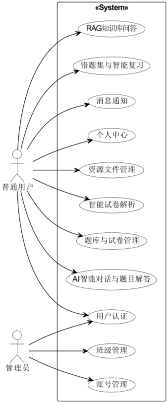
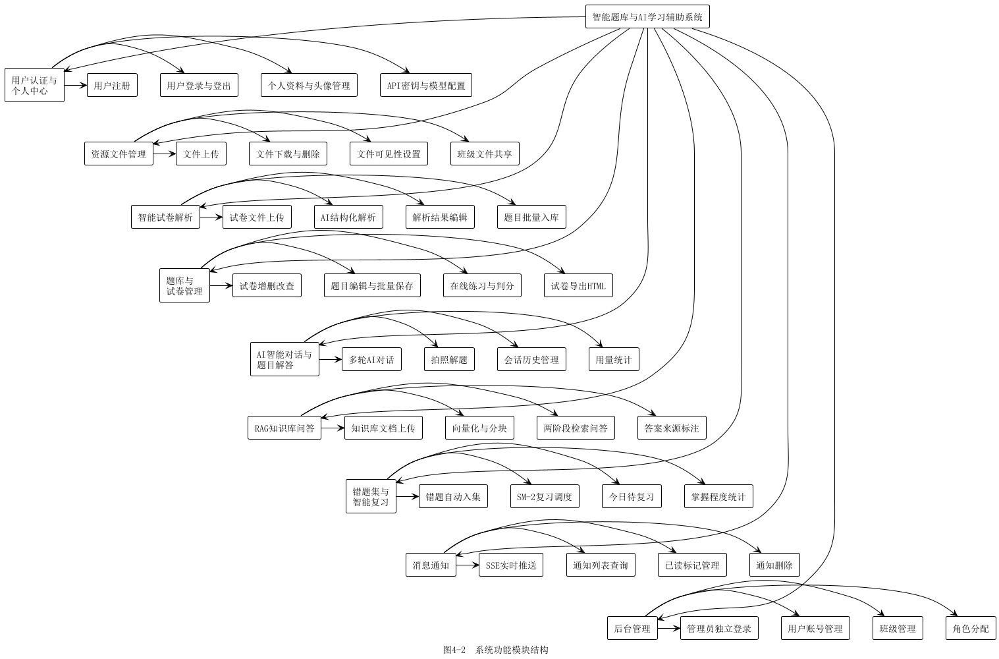

# PKQB · AI Question Bank Generation System

> An AI-driven question bank management and smart learning platform built on **Spring AI Alibaba ReactAgent**, combining RAG knowledge-base Q&A, AI-generated questions, and SM-2 spaced repetition. It gives students a closed learning loop: generate questions → practice → review mistakes → ask for help.

> Language: [中文](README.md) | English

---

## Table of Contents

- [Overview](#overview)
- [Core Features](#core-features)
- [Architecture](#architecture)
- [Tech Stack](#tech-stack)
- [Technical Highlights](#technical-highlights)
- [Database Design](#database-design)
- [Project Structure](#project-structure)
- [Quick Start](#quick-start)
- [API Overview](#api-overview)
- [Deployment](#deployment)

---

## Overview

PKQB (AI Question Bank Generation System) is a front-end/back-end separated AI education application that solves three problems:

1. **AI question generation**: upload Word/PDF exam papers or enter knowledge points, and the AI extracts six question types (single choice / multiple choice / fill-in-the-blank / true-false / calculation / short answer) together with answers, explanations, and calculation steps.
2. **RAG knowledge-base Q&A**: students upload study materials to build private or class-level knowledge bases, and answer questions through two-stage retrieval (vector coarse ranking + qwen3-rerank fine ranking).
3. **Spaced repetition for mistakes**: based on the SM-2 memory algorithm, wrong answers are collected automatically and scheduled for scientific review.

The system uses **Spring Boot 3.2 + Vue 3**, integrates the **Spring AI Alibaba 1.1.2** ReactAgent multi-agent framework, and delivers AI streaming output and real-time notifications over SSE (Server-Sent Events).

---

## Core Features

| Module | Description |
|--------|-------------|
| **Authentication** | Register / login / logout, JWT authentication, Argon2id password hashing |
| **Model Management** | User-supplied API keys (encrypted at rest), multiple channels such as Alibaba Cloud Bailian (DashScope) and OpenAI-compatible APIs, with main / auxiliary / vision models |
| **File Management** | Word/PDF parsing, image recognition, Alibaba Cloud OSS object storage, class file sharing, 50MB per-file limit |
| **Question Bank** | Paper CRUD, batch management, six question types, AI generation, HTML paper export |
| **AI Chat** | ReactAgent multi-agent chat + RAG knowledge-base Q&A, SSE streaming |
| **AI Solving** | Take a photo or upload a question; the AI recognizes it and returns answer plus explanation |
| **Wrong Questions** | Automatic collection, SM-2 spaced repetition, four-level mastery statistics |
| **Notifications** | SSE real-time push, seven notification types, message center |
| **Class Management** | Class creation, file sharing, public question banks |
| **History** | Chat history persistence, deletion, regenerate, usage statistics |
| **Audit Logging** | AOP aspect records critical operations, API rate limiting |
| **Admin Console** | Standalone admin frontend, dedicated admin login, account management (paging / create / edit / logical delete / reset password), class management (CRUD) |



---

## Architecture

### Overall Architecture

The system is layered:

- **Client layer**: browser / mobile
- **Frontend layer**: student app built with Vue 3 + TypeScript + Vite + Pinia + Axios; a separate admin project `admin-frontend` on port 3001
- **Gateway layer**: Nginx reverse proxy + static hosting
- **Backend layer**: Spring Boot 3.2 (port 5555) with Auth / File / AI / Rubric / Wrong / Notification / User modules plus an admin module
- **AI capability layer**: Spring AI Alibaba / DashScope / OpenAI-compatible APIs / ReactAgent / RAG
- **Storage layer**: MySQL 8.0 (business data) + Redis (cache / vector store / conversation memory) + Alibaba Cloud OSS (object storage)

### Functional Module Structure



---

## Tech Stack

### Backend

| Category | Technology | Version | Purpose |
|----------|------------|---------|---------|
| **Core framework** | Spring Boot | 3.2.5 | Web framework, auto-configuration |
| **AI framework** | Spring AI Alibaba | 1.1.2.0 | ReactAgent multi-agent, unified access to DashScope and OpenAI-compatible channels |
| **AI tooling** | Spring AI | 1.1.2 | Vector Store, Tika/PDF Document Reader, Advisors, OpenAI Starter |
| **ORM** | MyBatis-Plus | 3.5.5 | Persistence, pagination, code generation |
| **Database** | MySQL | 8.0+ | Business data |
| **Cache / vector store** | Redis | 8.0+ | Cache, Redis Vector Store, ReactAgent conversation memory |
| **Redis client** | Jedis / Redisson | 5.2.0 / 3.27.2 | Connection pool, distributed locks (RedisSaver) |
| **Object storage** | Alibaba Cloud OSS | SDK 3.18.1 | Files, paper HTML, avatars |
| **Document parsing** | Apache POI / PDFBox | 5.4.0 / 3.0.7 | Word / PDF parsing |
| **Auth** | JJWT | 0.12.5 | JWT generation and validation |
| **Password hashing** | Argon2 (argon2-jvm) | 2.11 | PHC-winning password hash |
| **Real-time** | SseEmitter (Spring MVC) | - | Notification push (Server-Sent Events) |
| **API docs** | springdoc-openapi | 2.5.0 | OpenAPI 3.0 documentation |
| **AOP** | spring-boot-starter-aop | - | Audit log aspect |

### Frontend

| Category | Technology | Version | Purpose |
|----------|------------|---------|---------|
| **Framework** | Vue | 3.4.21 | Reactive UI framework |
| **Build tool** | Vite | 5.2.6 | Dev server, bundling |
| **Language** | TypeScript | 5.4.3 | Type safety |
| **State management** | Pinia | 2.1.7 | Global state |
| **Routing** | Vue Router | 4.3.0 | SPA routing |
| **HTTP** | Axios | 1.6.8 | API requests |
| **Markdown** | marked | 18.0.2 | AI reply rendering |
| **PWA** | Service Worker | - | Offline cache, installable |

---

## Technical Highlights

> Designs worth exploring in depth during interviews.

### 1. Spring AI Alibaba ReactAgent Multi-Agent Architecture

Three focused agents are managed as Spring beans and routed by scenario:

| Agent | Responsibility | System prompt | Hooks |
|-------|----------------|---------------|-------|
| `chatReactAgent` | General study assistant | Heuristic tutor | SummarizationHook + ModelCallLimitHook |
| `ragReactAgent` | RAG knowledge-base Q&A | KB assistant distinguishing cited vs. uncited answers | RagAgentHook + SummarizationHook + ModelCallLimitHook |
| `simpleReactAgent` | Lightweight tasks (e.g. solving) | Default | None |

**Key design points**:
- **SummarizationHook**: compresses long conversations once the context exceeds 4000 tokens, keeping the latest 20 messages to avoid token overflow while preserving short-term memory.
- **ModelCallLimitHook**: caps tool calls per turn at 3 to prevent infinite loops.
- **MemorySaver**: persists conversation state, enabling multi-turn restoration by sessionId.

See [ReactAgentConfig.java](backend/src/main/java/pkqb/config/ReactAgentConfig.java).

### 2. RAG Two-Stage Retrieval (Coarse + Fine Ranking)

Instead of single-stage vector search, the system uses a recall-first, precision-second strategy to reduce retrieval noise:

```
User query
  │
  ▼
Step 1: Coarse ranking (vector search, Redis Vector Store)
        ├─ topK = 20 (wider recall)
        └─ similarityThreshold = 0.5
  │
  ▼
Step 2: Fine ranking (qwen3-rerank semantic re-ranking)
        └─ topN = 5 (descending relevance)
  │
  ▼
Inject into agent context → generate answer
```

**Implementation notes**:
- Coarse ranking uses Spring AI's `VectorStore.similaritySearch()` backed by the Redis vector index.
- Fine ranking calls Alibaba Bailian's `qwen3-rerank` model through the custom [DashScopeRerankService](backend/src/main/java/pkqb/service/DashScopeRerankService.java).
- Graceful degradation: if rerank fails, the top-N items from coarse ranking are returned in their original order.
- **Data isolation**: `RAGSearchTool` filter expressions enforce permission boundaries between private and class-public knowledge bases.

### 3. Custom Agent Hook Extension

`RagAgentHook` extends `AgentHook` and injects RAG context via `@HookPositions({HookPosition.BEFORE_AGENT})`, decoupling retrieval from agent reasoning:

- The agent itself knows nothing about retrieval, preserving single responsibility.
- Retrieval context travels through `OverAllState` and `RunnableConfig.metadata` during the agent lifecycle.
- The same capability is also exposed as a tool (`RAGSearchTool` registered as `FunctionToolCallback`) so the agent can retrieve on demand.

See [RagAgentHook.java](backend/src/main/java/pkqb/config/RagAgentHook.java).

### 4. Strategy Pattern for Multi-Type Question Parsing

Structured extraction for six question types follows the open/closed principle:

```
QuestionExtractStrategy (interface)
  ├─ SingleChoiceQuestionStrategy      single choice
  ├─ MultipleChoiceQuestionStrategy    multiple choice
  ├─ FillBlankQuestionStrategy         fill in the blank
  ├─ TrueFalseQuestionStrategy         true / false
  ├─ CalculationQuestionStrategy       calculation
  └─ ShortAnswerQuestionStrategy       short answer
```

`QuestionExtractContext` holds all strategies and picks one based on text features. Adding a new question type only requires a new strategy implementation.

### 5. SM-2 Spaced Repetition Algorithm

The wrong-question book implements the classic **SM-2 (SuperMemo 2)** algorithm:

**Parameters**:
- `ease_factor` (EF): starts at 2.5, floor 1.3, reflects how hard the item is for the user
- `interval_days`: days until the next review
- `mastery_level`: 0-3

**Update rules**:
- Correct: `EF = EF + (0.1 - (5-q) * (0.08 + (5-q) * 0.02))`, interval grows with EF
- Wrong: `EF = max(1.3, EF - 0.2)`, interval resets to 1 day, mastery resets to zero

**Mastery levels**:

| Level | Label | Condition |
|-------|-------|-----------|
| 0 | Not mastered | initial / reset after a wrong answer |
| 1 | Preliminary | 1-2 correct answers |
| 2 | Basically mastered | 3-4 correct answers |
| 3 | Fully mastered | 5+ correct answers and EF ≥ 2.0 |

See [WrongQuestionServiceImpl.java](backend/src/main/java/pkqb/service/impl/WrongQuestionServiceImpl.java).

### 6. Unified SSE Real-Time Communication

Each real-time scenario uses the mechanism that fits it best:

| Scenario | Technology | Rationale |
|----------|------------|-----------|
| AI streaming chat | Fetch + ReadableStream (SSE format) | One-way streaming, custom request headers |
| Real-time notifications | SseEmitter + EventSource | Server push, native browser reconnection |

**Notification SSE details**:
- Endpoint `GET /api/notification/subscribe` (`text/event-stream`) reuses JWT interceptor auth (token priority: header > URL param > cookie)
- `CopyOnWriteArrayList<SseEmitter>` supports multiple connections per user; dead connections are cleaned up
- 25s heartbeat comments (`:ping`) prevent idle timeouts on Nginx and other proxies
- `X-Accel-Buffering: no` disables proxy buffering so events are delivered immediately
- Seven notification types: paper parsing success/failure, HTML generation complete, KB upload success/failure, AI solving complete, system messages
- The frontend uses native `EventSource` with automatic reconnection; when the token expires, it rebuilds the connection manually with the latest token from localStorage

See [NotificationSseManager.java](backend/src/main/java/pkqb/config/NotificationSseManager.java), [NotificationController.java](backend/src/main/java/pkqb/controller/NotificationController.java) and [useWebSocket.ts](frontend/src/composables/useWebSocket.ts).

### 7. Security Design

| Area | Approach |
|------|----------|
| **Password hashing** | Argon2id (2025 PHC winner), resistant to GPU/ASIC cracking |
| **API key protection** | User API keys encrypted via [ApiKeyEncryptor](backend/src/main/java/pkqb/util/ApiKeyEncryptor.java), never stored in plaintext |
| **Authentication** | JWT validated uniformly by an interceptor (shared by REST and SSE subscriptions) |
| **Audit log** | `@AuditLog` annotation + AOP aspect ([AuditLogAspect](backend/src/main/java/pkqb/aspect/AuditLogAspect.java)) |
| **Rate limiting** | Redis sliding-window limiter in [RateLimitService](backend/src/main/java/pkqb/service/RateLimitService.java) |
| **Exception handling** | `@RestControllerAdvice` plus the `Result<T>` response envelope |
| **Soft delete** | Papers and questions use a `deleted` flag to avoid accidental data loss |
| **Admin authorization** | `AdminInterceptor` guards `/api/admin/**` and checks `role=1`; admins log in through a dedicated endpoint; `user.deleted` uses logical deletion (`@TableLogic`) |

### 8. Multi-Channel Model Adapter (Factory Pattern)

`ModelProvider` abstracts model construction per vendor, and `ModelProviderFactory` registers and routes providers by channel. Users can pin each configured model to a channel:

- `DashScopeModelProvider`: Alibaba Cloud Bailian (qwen / deepseek and more), including vision models and the multimodal-generation endpoint;
- `OpenAIModelProvider`: OpenAI-compatible APIs via `base-url`, covering OpenAI, DeepSeek, and Claude-compatible proxies;
- Channels are defined by the `ModelChannel` enum; the model channel is stored in `models.model_channel`, while the user channel lives in `user.model_channel` and is cached in Redis;
- Adding a channel only requires implementing `ModelProvider` and registering it as a Spring bean; callers stay unchanged.

See [ModelProviderFactory.java](backend/src/main/java/pkqb/config/ModelProviderFactory.java).

---

## Database Design

### Core Tables

| Table | Description | Key columns |
|-------|-------------|-------------|
| `class` | Classes | id, class_name |
| `user` | Users | id, username, password_hash, student_no, class_id, role (0 user / 1 admin), model_channel, deleted |
| `rubric` | Papers (soft delete) | id, title, create_id, is_private, question_count |
| `question` | Questions (soft delete) | id, rubric_id, question_type, options_json, answer, explanation |
| `question_resource` | Question assets | images for questions, options, and answers |
| `file` | Files | id, user_id, minio_key (OSS object key, legacy column name), is_private |
| `models` | Per-user model config | id, user_id, model_name, model_type, model_channel, multi_model, enable_thinking |
| `wrong_question` | Wrong questions | SM-2 parameters (ease_factor, interval_days, next_review_date, mastery_level) |
| `notification` | Notifications | id, user_id, type, is_read |
| `audit_log` | Audit log | operation records |

Incremental migrations live in [backend/src/main/resources/db/migration/](backend/src/main/resources/db/migration/):

- [V1__add_model_channel.sql](backend/src/main/resources/db/migration/V1__add_model_channel.sql) — adds channel, multimodal, and thinking-mode columns to `models` and `user`
- For a fresh environment, import the base schema first, then apply migrations in version order

---

## Project Structure

```
PKQB/
├── backend/                          # Backend service
│   ├── src/main/java/pkqb/
│   │   ├── PkqbApplication.java      # Entry point
│   │   ├── controller/               # Controllers (7)
│   │   │   └── admin/                # Admin controllers (AdminAuth/AdminUser/AdminClass)
│   │   ├── service/                  # Business services
│   │   │   ├── impl/                 # Implementations
│   │   │   └── strategy/             # Strategy pattern (question parsing)
│   │   ├── config/                   # Configuration (AI/model channels/SSE/Redis/OSS/Swagger)
│   │   ├── tool/                     # AI tools (RAGSearchTool/ImageViewTool)
│   │   ├── interceptor/              # Interceptors (JWT/Log/Admin)
│   │   ├── aspect/                   # AOP aspect (audit log)
│   │   ├── annotation/               # Custom annotations (@AuditLog)
│   │   ├── mapper/                   # MyBatis-Plus mappers
│   │   ├── pojo/                     # Entities and DTOs
│   │   │   ├── entity/               # Database entities
│   │   │   └── dto/                  # Data transfer objects (incl. admin)
│   │   ├── enums/                    # Enums (question types/model types/model channels)
│   │   ├── common/                   # Shared classes (Result/constants)
│   │   └── util/                     # Utilities (JWT/Argon2id/ApiKeyEncryptor)
│   └── src/main/resources/
│       ├── application.yml           # Main config (MySQL/Redis/OSS/model channels/timeouts & parse limits)
│       ├── application-prod.yml      # Production overrides
│       ├── db/migration/             # Incremental database migrations
│       └── templates/                # Paper HTML templates
│
├── frontend/                         # Student app
│   ├── src/
│   │   ├── views/                    # Pages (12)
│   │   │   ├── Home.vue
│   │   │   ├── Login.vue / Register.vue
│   │   │   ├── MyFiles.vue           # Files / practice
│   │   │   ├── ClassFiles.vue        # Class files
│   │   │   ├── RubricUpload.vue      # Paper upload
│   │   │   ├── AIChat.vue            # AI chat
│   │   │   ├── RAGChat.vue           # RAG Q&A
│   │   │   ├── KBUpload.vue          # Knowledge-base upload
│   │   │   ├── WrongQuestionBook.vue # Wrong questions
│   │   │   ├── History.vue           # Chat history
│   │   │   ├── Settings.vue          # Settings
│   │   │   └── Upload.vue            # File upload
│   │   ├── components/               # Shared components
│   │   ├── composables/              # Composables (useWebSocket/useToast, etc.)
│   │   ├── stores/                   # Pinia stores
│   │   ├── api/                      # Axios wrapper and API definitions
│   │   ├── router/                   # Routes
│   │   └── types/                    # TypeScript types
│   └── public/                       # Static assets (PWA manifest/sw.js)
│
├── admin-frontend/                   # Admin app (standalone)
│   └── src/
│       ├── views/                    # Pages (Login/AdminUsers/AdminClasses/Layout)
│       ├── components/               # Shared components (ToastContainer)
│       ├── composables/              # Composables (useToast)
│       ├── stores/                   # Pinia stores (auth)
│       ├── api/                      # Axios wrapper and admin API definitions
│       ├── router/                   # Routes (with auth guard)
│       └── types/                    # TypeScript types
│
└── docs/                             # Diagrams (only the two images below are committed)
    ├── 系统功能模块结构图.png
    └── 系统用例图.png
```

---

## Quick Start

### Requirements

| Dependency | Version |
|------------|---------|
| Java | 17+ |
| Node.js | 18+ |
| Maven | 3.8+ |
| MySQL | 8.0+ |
| Redis | 8.0+ |
| Alibaba Cloud OSS | Bucket provisioned (other compatible object storage also works) |

### 1. Prepare Infrastructure

```bash
# Start MySQL and Redis (Docker example)
docker run -d --name mysql -p 3306:3306 -e MYSQL_ROOT_PASSWORD=your_password mysql:8.0
docker run -d --name redis -p 6379:6379 redis:8.0
```

Object storage uses Alibaba Cloud OSS, so no local service is needed. Configure the `aliyun-oss` endpoint, AccessKey, and bucket name in `application.yml`.

### 2. Initialize the Database

```bash
# Create the database
mysql -u root -p -e "CREATE DATABASE IF NOT EXISTS pkqb DEFAULT CHARSET utf8mb4"

# Import the base schema, then apply incremental migrations in version order
mysql -u root -p pkqb < backend/src/main/resources/db/migration/V1__add_model_channel.sql
```

> A fresh environment must import the base schema first, then run the migrations under `db/migration/`.

### 3. Start the Backend

```bash
cd backend
# Edit src/main/resources/application.yml with MySQL/Redis/OSS/DashScope settings;
# for OpenAI-compatible channels, also set pkqb.ai.openai.base-url and PKQB_AI_OPENAI_KEY
./mvnw spring-boot:run
```

The backend runs at http://localhost:5555 and the API docs are at http://localhost:5555/swagger-ui.html.

### 4. Start the Student Frontend

```bash
cd frontend
npm install
npm run dev
```

The student app runs at http://localhost:5173.

### 5. Start the Admin Frontend

```bash
cd admin-frontend
npm install
npm run dev
```

The admin app runs at http://localhost:3001. Use an existing account with `role=1`.

---

## API Overview

The system exposes RESTful APIs across 8 modules with 40+ endpoints. Full documentation is available in Swagger UI.

### Authentication

| Endpoint | Method | Description |
|----------|--------|-------------|
| `/api/auth/register` | POST | Register |
| `/api/auth/login` | POST | Log in |
| `/api/auth/logout` | POST | Log out |

### User

| Endpoint | Method | Description |
|----------|--------|-------------|
| `/api/user/info` | GET | Get user info |
| `/api/user/username` | PUT | Update username |
| `/api/user/password` | PUT | Change password |
| `/api/user/avatar` | POST/PUT | Upload / update avatar |

### API Keys and Models

| Endpoint | Method | Description |
|----------|--------|-------------|
| `/api/apikey` | POST/DELETE | Set / delete API key |
| `/api/apikey/status` | GET | API key status |
| `/api/apikey/model` | POST/DELETE | Add / delete model (pass `modelChannel` on add: `dashscope` / `openai`) |
| `/api/apikey/model/main` | PUT | Set main model |
| `/api/apikey/models` | GET | List models |

> Channels are defined by `ModelChannel`. Two providers are implemented today: `dashscope` (Alibaba Cloud Bailian) and `openai` (OpenAI-compatible). Additional enum values are reserved for future channels.

### Question Bank

| Endpoint | Method | Description |
|----------|--------|-------------|
| `/api/rubric/add-rubric` | POST | Create paper |
| `/api/rubric/my` | GET | My papers |
| `/api/rubric/public` | GET | Public papers |
| `/api/rubric/{id}/questions` | GET | Get questions |
| `/api/rubric/update` | PUT | Update paper |
| `/api/rubric/{id}` | DELETE | Delete paper |
| `/api/rubric/batch` | DELETE | Batch delete papers |
| `/api/rubric/question/update` | PUT | Update question |
| `/api/rubric/{id}/questions/batch` | POST | Batch save questions |
| `/api/rubric/generate-html` | POST | Generate paper HTML |
| `/api/rubric/upload-image` | POST | Upload question image |

### Files

| Endpoint | Method | Description |
|----------|--------|-------------|
| `/api/files/upload` | POST | Upload file |
| `/api/files/my` | GET | My files |
| `/api/files/class/public` | GET | Class public files |
| `/api/files/download/{id}` | GET | Download file |
| `/api/files/{id}` | DELETE/PUT | Delete / update file |
| `/api/files/batch` | DELETE | Batch delete files |

### AI Chat

| Endpoint | Method | Description |
|----------|--------|-------------|
| `/api/ai/query` | POST | Multi-agent chat (SSE streaming) |
| `/api/ai/rag-query` | POST | RAG Q&A (SSE streaming) |
| `/api/ai/add-documentsFile` | POST | Upload documents to the knowledge base |
| `/api/ai/handle-rubricFile` | POST | Parse paper files with image recognition |
| `/api/ai/ai-solve` | POST | AI solving |
| `/api/ai/get-historyList` | GET | Chat history list |
| `/api/ai/get-history-by-sessionId` | GET | Messages of a session |
| `/api/ai/delete-history` | DELETE | Delete a session |
| `/api/ai/usage` | GET | AI usage statistics |

> Long papers: 50MB per file and at most 300 pages / 200 text chunks per parse (see `pkqb.ai.parse`). Larger inputs prompt the user to split the upload.

### Wrong Questions

| Endpoint | Method | Description |
|----------|--------|-------------|
| `/api/wrong-question` | POST | Add a wrong question (duplicates accumulate) |
| `/api/wrong-question/list` | GET | List wrong questions grouped by paper |
| `/api/wrong-question/today-review` | GET | Today's review queue |
| `/api/wrong-question/review` | POST | Submit review result (updates SM-2 parameters) |
| `/api/wrong-question/stats` | GET | Wrong-question statistics |
| `/api/wrong-question/{id}` | DELETE | Delete a wrong question |

### Notifications

| Endpoint | Method | Description |
|----------|--------|-------------|
| `/api/notification/subscribe` | GET | SSE notification subscription |
| `/api/notification/list` | GET | Notification list |
| `/api/notification/unread-count` | GET | Unread count |
| `/api/notification/read/{id}` | PUT | Mark as read |
| `/api/notification/read-all` | PUT | Mark all as read |
| `/api/notification/{id}` | DELETE | Delete notification |

### Admin (requires role=1, enforced by AdminInterceptor)

| Endpoint | Method | Description |
|----------|--------|-------------|
| `/api/admin/auth/login` | POST | Admin login (dedicated endpoint, not `/auth/login`) |
| `/api/admin/user/page` | GET | Paginated accounts (filter by keyword/class/role) |
| `/api/admin/user` | POST | Create account (with initial password) |
| `/api/admin/user/{id}` | PUT | Update account (username/student no/class/role) |
| `/api/admin/user/{id}` | DELETE | Delete account (logical delete, deleted=1) |
| `/api/admin/user/{id}/password` | PUT | Reset password |
| `/api/admin/class` | GET/POST | List all classes / create class |
| `/api/admin/class/{id}` | PUT/DELETE | Update / delete class (physical delete, rejected if referenced) |

---

## Deployment

### Development

```bash
# Terminal 1: backend
cd backend && ./mvnw spring-boot:run

# Terminal 2: student frontend
cd frontend && npm run dev

# Terminal 3: admin frontend
cd admin-frontend && npm run dev
```

### Production

1. **Build the frontends**:

```bash
# Student app
cd frontend && npm run build

# Admin app
cd ../admin-frontend && npm run build
```

2. **Deploy the frontends**: serve `frontend/dist/` and `admin-frontend/dist/` from Nginx with a reverse proxy:

```nginx
server {
    listen 80;
    server_name your-domain.com;

    # Paper PDFs up to 50MB; keep in sync with the backend multipart limit
    client_max_body_size 50m;

    # Admin static assets (separate path to avoid conflicts)
    location /admin/ {
        alias /path/to/admin-frontend/dist/;
        try_files $uri $uri/ /admin/index.html;
    }

    # Student static assets
    location / {
        root /path/to/frontend/dist;
        try_files $uri $uri/ /index.html;
    }

    # Backend API proxy
    location /api/ {
        proxy_pass http://backend:5555;
        proxy_set_header Host $host;
        proxy_set_header X-Real-IP $remote_addr;
        # SSE: disable buffering and extend read timeout
        proxy_buffering off;
        proxy_read_timeout 86400;
        proxy_set_header Connection "";
        proxy_http_version 1.1;
    }
}
```

3. **Deploy the backend**: build the JAR and run it

```bash
cd backend
./mvnw clean package -DskipTests
java -jar target/pkqb-0.0.1-SNAPSHOT.jar
```

### Deployment Notes

1. **Database migrations**: import the base schema first, then apply the scripts under `backend/src/main/resources/db/migration/` in version order.
2. **SSE proxy settings**: set `proxy_buffering off` and extend `proxy_read_timeout` when reverse-proxying the API, otherwise notification streams are buffered and delayed or dropped.
3. **HTTPS**: SSE works over plain HTTP and adapts to `https://` automatically; no extra configuration needed.
4. **Model and OSS credentials**: the default channel is Alibaba Cloud Bailian and needs `Spring_ai_alibaba`; OpenAI-compatible channels need `PKQB_AI_OPENAI_KEY` and `pkqb.ai.openai.base-url`; object storage needs `AccessKey_ID`, `AccessKey_Secret`, and the bucket name.
5. **Upload size**: the backend allows 50MB, so Nginx must set `client_max_body_size 50m;` or large uploads will be rejected with 413.
